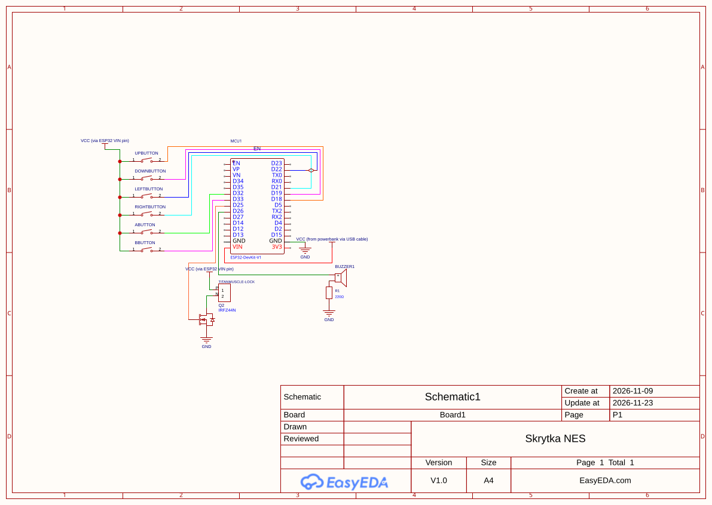

# konami-code-gadget-geocache
This is code for an electronic gadget cache styled around the NES which opens when you input the konami code into its fake NES controller.

The geocache isn't published yet, but will be soon-ish at [GCBZWW5](https://coord.info/GCBZWW5).

**Circuit schematic:**

**3D-printing files:**
1. Once I finish the project, I'll upload the STL files either here or on Instructables

**Hardware notes:**
1. I used an ESP32 as the microcontroller for the gadget cache, specifically the ESP32 Wroom Devkit V1
2. The latch I used is a cheap electric latch from Aliexpress, specifically the 2-line version of the [3~5V Titanmuscle Electric Lock](https://pl.aliexpress.com/item/1005002395126794.html?gatewayAdapt=glo2pol4itemAdapt)
3. At first I tried to power the cache using an 18650 cell, however it turned out it's not powerful enough to power the ESP32 and the lock at the same time. The ESP32 always browned out when it tried to open the lock so I gave up. Now, I'm planning to build the geocache assuming that each finder brings their own powerbank with a USB-A powerbank. This is an approach at least one other electronic gadget cache used (GCB7ENP). In a future project I'll probably try a different solution - either by designing a more sophisticated power switching circuit so the 18650 can power both devices or by powering the latch separately, with a AA or other small Battery. I imagined I'd have to switch out and charge the onboard 18650 every 1-3 months so a future project may also involve some small solar cells so I don't need to visit the site as often.
